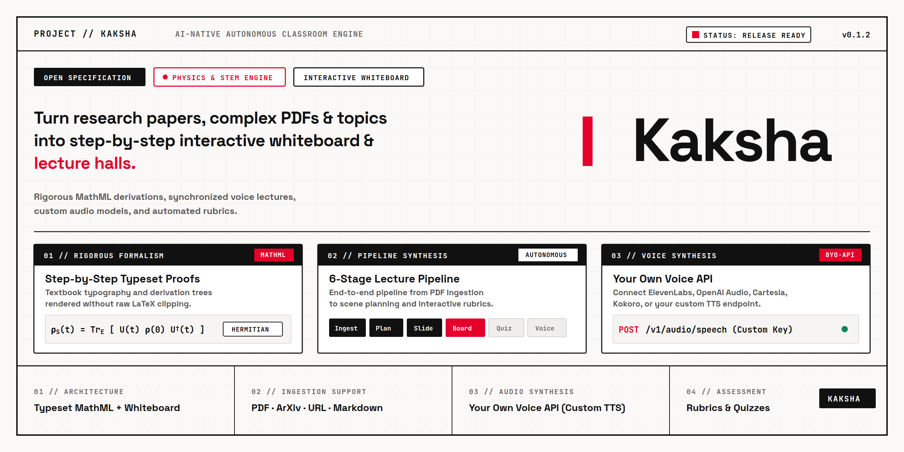
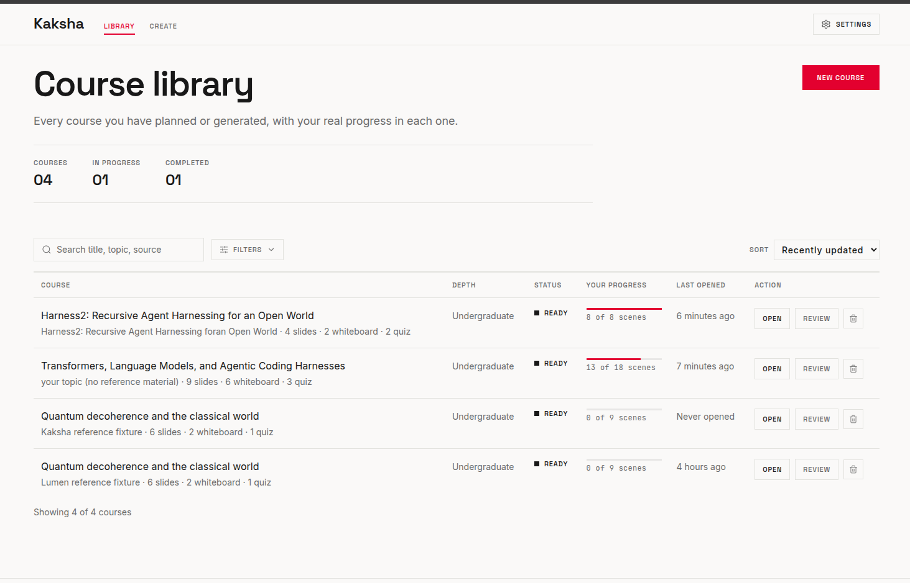
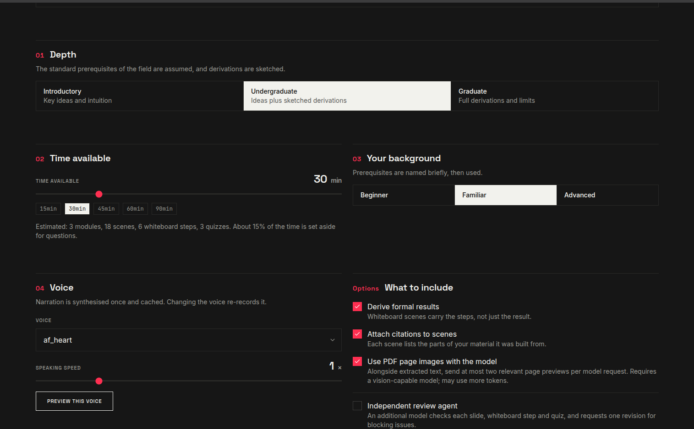
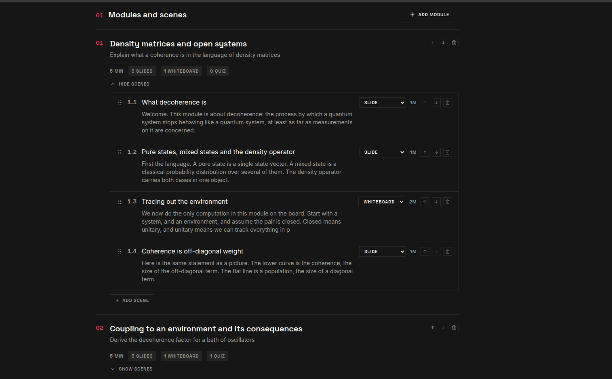
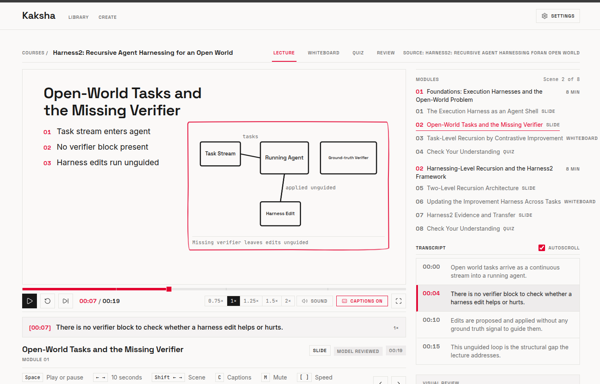
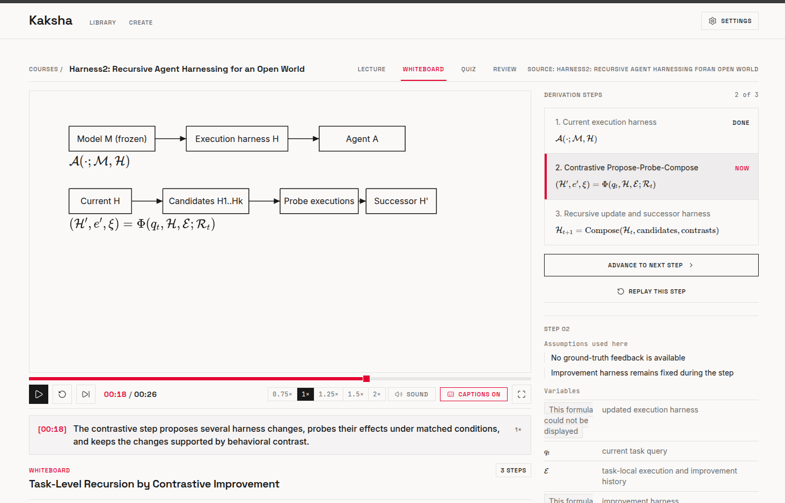
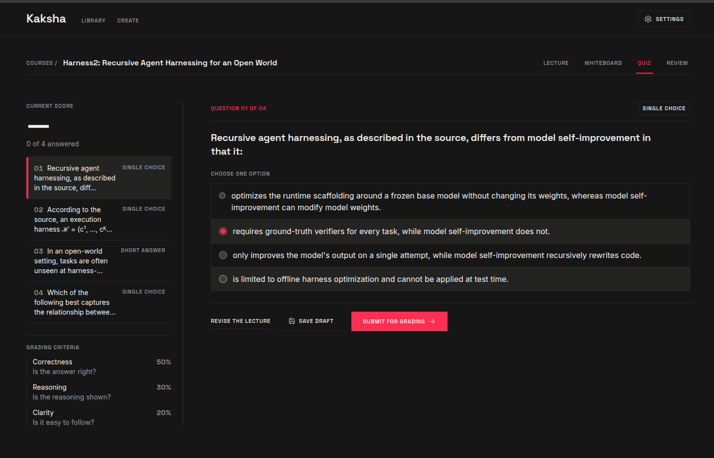
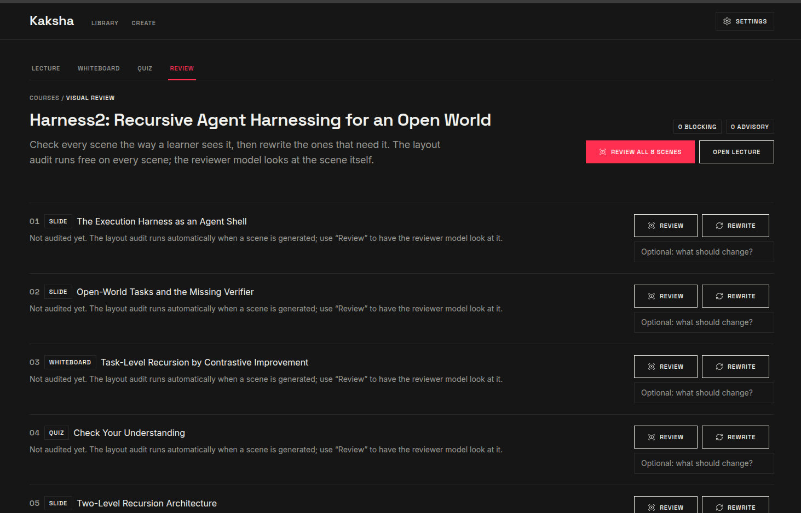

# Kaksha · AI classroom



Kaksha turns a topic or a document into a narrated, animated lecture: slides, a whiteboard the AI
draws on step by step, and quizzes graded against a rubric.

Further reading: [docs/architecture.md](docs/architecture.md) (how it fits together),
[docs/providers.md](docs/providers.md) (providers, slots and encryption),
[DECISIONS.md](DECISIONS.md) (why it works this way) and [CHANGELOG.md](CHANGELOG.md).

```
topic / paper / link / notes
  → ingest (parse, sections, chunks, index)
  → plan (depth, time budget, background)   → you review and edit the outline
  → scenes (slide | whiteboard | quiz), validated, with one repair pass
  → narration (browser voice, Kokoro speech, or an offline voice; cached, real durations)
  → one lesson document → the player
```

## Run it

```bash
npm install
cp .env.example .env          # DATABASE_URL points at your local Postgres
npx drizzle-kit push          # create the tables
npm run build && npm start    # http://localhost:3000
# or, while developing
npm run dev
```

Prefer containers? `docker compose up` runs the app and Postgres, and the Kokoro speech
service joins it with `docker compose --profile kokoro up`.

The first request seeds the reference course ("Quantum decoherence and the classical world"), a hand
authored lesson with slides, a whiteboard derivation and a quiz, so there is something to play
immediately.

## Configure models (Settings → 01 Models)

| Task | What it writes | Suggested model |
|---|---|---|
| Default | Used whenever a task has no model of its own | any |
| Planner | The outline and objectives | small and cheap is fine |
| Content | Slides, whiteboard steps, quizzes | the strongest model you have |
| Reviewer | The visual reviewer: teaching quality, sources, correctness, rendered screenshots | a vision-capable model (falls back to the default) |
| Grader | Marks short answers and derivations | a model with structured output |
| Tutor | Answers questions while you watch | any |
| Escalation | Only called when a scene fails twice, with the exact failure list | a stronger model at the same provider |

Providers: **OpenAI-compatible** (OpenAI, OpenRouter, DeepSeek, LM Studio, Gemini's compat endpoint,
Ollama's `/v1`), **Anthropic**, and **Ollama native** (`/api/chat` with `format: "json"`).

Local Ollama example: provider `Ollama (local)`, base address `http://127.0.0.1:11434`, model
`llama3.2`. Local addresses are allowed for providers only — never for material links.

With **no model configured**, Kaksha still runs end to end: the outline, scenes and quizzes are
drafted from your material by the built-in planner and writer, and short answers are marked by
keyword comparison with the reference answer. Every such course says so on the plan screen, and the
grader tells you its confidence is low. Nothing pretends to be model output.

## Visual review and grading

Every scene is audited by two reviewers before and after it is generated:

* **Deterministic layout audit** (no model, always on): text budget, element density,
  layout/content mismatch, missing diagrams on mechanism scenes, label collisions,
  figure captions and alt text, plot axes, and visual dead air. Blocking findings
  send the scene back for one repair pass; they are stored on the scene as `visual`.
* **Visual agent reviewer** (model, on demand in the player): the rendered stage is
  captured as a PNG and sent with the scene JSON to a vision model, which reports
  overflow, collisions, weak hierarchy, contrast problems and diagram quality.
  Open **Visual review → Review screenshot** in the lecture player.

Mechanism topics (transformers, the water cycle, an engine, a circuit) are planned
with at least one diagram scene, the slide prompt refuses to pass without a labelled
diagram, and a deterministic flow diagram is synthesised if a model still skips it.

Short answers and derivations are graded against a rubric with **semantic
equivalence and partial credit**: criterion ids are normalised (renamed ids and
0–100 scales no longer collapse to zero), every covered key point earns marks, and
a floor is applied so a correct paraphrase can never score 0%.

## Resilient retries and an escalation model

A rejected LLM reply no longer triggers a vague "try again". `generateStructured`
builds a focused retry prompt that lists the exact validation failures, shows
what was rejected, and asks for a single-pass rewrite with a pre-answer
self-check. A second repair only happens for parse failures; anything else is
escalated rather than repeated.

**Escalation model**: enable it on Create (or as a default in Settings). After a
scene fails twice, that one request goes to the dedicated **Escalation** model
slot with the accumulated failure list. It also appears as the "Use smarter
model" button on any failed scene. No extra provider is needed: when the
deployment supplies `MODEL_NAME` / `BASE_URL` / `API_KEY`, Kaksha derives a
stronger variant of the same provider's family automatically (or you can pick
one in Settings → 01 Models). A stronger model is only called when a scene
actually fails, so a clean generation costs nothing extra.

## Library filters (bounded facets)

The library uses a fixed set of facets — status, depth, progress — plus search
and sort. It never generates chips from course titles, so a library with hundreds
of lectures stays usable. Facets are collapsible, show counts, and clear in one
click.

## Speech

Speech degrades instead of failing, and you pick the fallback order in Settings → 03 Speech:

* `Browser voice + captions (no service)` (default): the narration plays through the browser's own
  speech voice when one is available, with captions timed from the text at 150 words per minute.
* `Kokoro over HTTP`: point Kaksha at a Kokoro service that exposes an OpenAI-compatible
  `/v1/audio/speech`, for example [Kokoro-FastAPI](https://github.com/remsky/Kokoro-FastAPI)
  (`docker run -p 8880:8880 ghcr.io/remsky/kokoro-fastapi-cpu`), then set the address to
  `http://127.0.0.1:8880/v1/audio/speech`. Segments are cached by content hash, so nothing is
  synthesised twice, and the real duration is read from the encoded file.
* **Offline device voice**: when no browser voice is found (or the one that starts errors out),
  Kaksha renders the segment with `espeak-ng` on the server — the Docker image ships it — and tells
  you it is doing so. Nothing hangs, and the lecture keeps playing.

In the player, the narration mode cycles `auto` (a generated audio file if there is one, else the
browser voice) → `browser` → `captions`, and the status bar shows which one is active.

## Layout

```
src/app            routes (library, create, plan, generating, lecture, whiteboard, quiz, settings)
src/app/api        JSON + SSE endpoints
src/components     ui primitives, player, slides, whiteboard, quiz
src/lib/dsl        the lesson format and its validator (single source of truth)
src/lib/player     computeSceneState, the clock and the player store
src/server         providers (llm, tts), ingest, prompts, pipeline, grading, settings
tests              vitest suites (DSL, player, grading)
```

## Tests

```bash
npx vitest run          # DSL validation, fixture, player state, grading
npx next typegen        # route types
npm exec tsc -- --noEmit
npm run lint
```

## Troubleshooting

* **"No language model is configured"** — Settings → 01 Models, then use *Test connection*. The
  reply time you see is a real round trip.
* **A scene failed** — the Generating screen shows the reason and a Retry button; only that scene is
  re-run.
* **A PDF produced little or no text** — the parser says so under the staged file ("N of M processed
  pages have little extractable text"), because scanned pages carry no text layer. Kaksha then uses
  the page images when a vision-capable model is configured; otherwise those pages stay empty.
* **The theme, caption size or reduced-motion choice does not stick** — appearance is saved in this
  browser's local storage (`kaksha.appearance`), not on the account. Switch it in Settings → 04
  Appearance; *Match system* follows your operating system.

## Screens

| | |
|---|---|
|  |  |
|  |  |
|  |  |
|  | |
